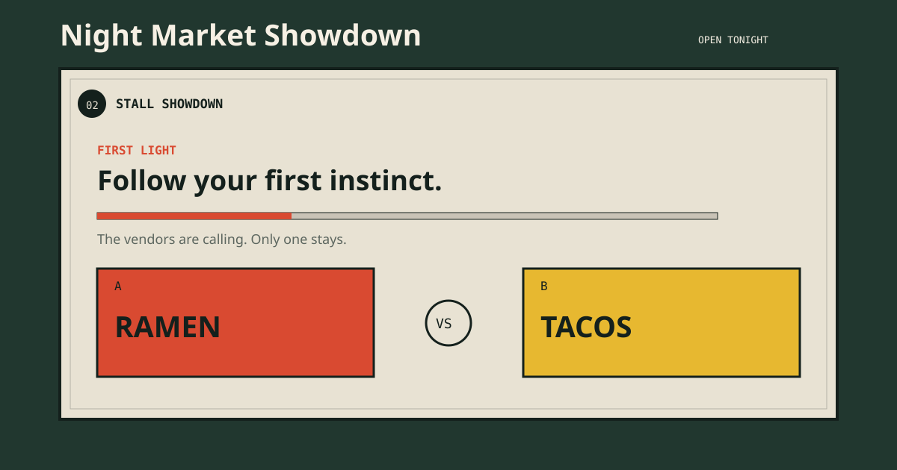

# Night Market Showdown

Night Market Showdown is a small interactive web game for people who cannot decide what to eat. Players enter a shortlist, set three appetite clues, and eliminate one food at a time until a final order is locked.

## Intended user

This experience is for someone who has two to eight lunch options and wants to make a decision in about a minute. It does not claim to identify the objectively best food. Instead, it turns a low-pressure series of choices into a playful night-market showdown that helps the user notice their immediate preference.

## Main interaction

1. Enter 2–8 lunch options, separated by commas or line breaks.
2. Set a hunger level, available time, and mood.
3. Choose between two market-stall contenders in each round. The winner stays for the next challenger.
4. Read the final receipt, which records the winner, appetite clues, and number of challengers beaten.
5. Replay with the same shortlist or start a new one.

Extra features:

- **Market Intelligence Desk:** choose a budget and craving to receive three built-in food ideas, then add any idea to the showdown.
- **Tie-breaker:** flip a coin once per game when two options are impossible to separate.
- **Locked-order history:** the most recent five results stay in the current browser and can be cleared at any time. No result is uploaded anywhere.

The game gives a clear error if fewer than two unique options are entered or if the shortlist has more than eight options.

## Run it

Play the live version here: [Night Market Showdown](https://chengxiran.github.io/lunch-duel/).

This is also a static, dependency-free web project. To run it locally, open index.html directly in a browser, or start a local web server from this folder with Python and visit http://localhost:8000.

## Technology and limitations

The project uses plain HTML, CSS, and JavaScript: no framework, API, account, or paid service is required. The appetite clues enrich the game’s narrative but do not claim to provide live restaurant data, prices, nutrition, allergy guidance, distance, or opening times. The font files come from Google Fonts; the core experience still works with local fallback fonts when the service is unavailable.

## Files

- index.html — page structure and accessible labels
- style.css — responsive ticket-and-night-market visual design
- script.js — game state, recommendations, tie-breaker, local history, and error handling
- PROCESS.md — design and testing process
- CREDITS.md — credits for tools and materials

## AI disclosure

OpenAI Codex was used to help plan the page structure, identify error cases, and check documentation coverage. The author reviewed and edited the interaction rules, written content, visual direction, and final code. See PROCESS.md for detail.
