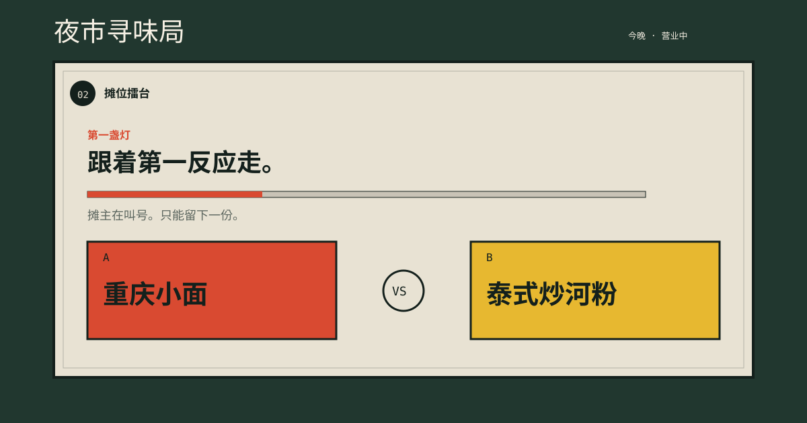

# 午餐对决

一个帮助犹豫的人快速决定午餐的小网页。把候选午餐放进对决台，每轮选出你此刻更想吃的一个；胜者继续面对下一位挑战者，直到产生今天的午餐冠军。



## 给谁用？

给午餐时间到了、却在多个选项之间犹豫不决的人。它不试图替人判断“最好”的食物，而是用连续、低压力的二选一，让用户根据第一反应做决定。

## 主要交互

1. 输入 2–8 个午餐候选项（逗号、顿号或换行均可）。
2. 在每轮的两张食物卡中点选较想吃的一项。
3. 页面即时更新下一轮和进度；最后显示冠军。
4. 可以再来一局，或返回修改候选项。

如果没有至少两个不同的候选项，或候选项超过八个，页面会说明问题并阻止开始。

## 如何运行

这是一个无依赖的静态网页：直接双击 `index.html`，或在本目录启动任意静态服务器后打开即可。例如，安装了 Python 时：

```bash
python -m http.server 8000
```

然后访问 `http://localhost:8000`。

## 技术与限制

使用原生 HTML、CSS 和 JavaScript，没有外部框架或 API。程序只根据用户的连续二选一产生结果；它不会考虑距离、价格、过敏原、营业状态或营养信息。界面字体通过 Google Fonts 加载；若网络不可用，浏览器会使用本地后备字体，核心交互仍可正常工作。

## 文件

- `index.html`：页面结构与可访问性标签
- `style.css`：响应式视觉设计
- `script.js`：候选项解析、对决状态和错误处理
- `PROCESS.md`：设计与测试过程
- `CREDITS.md`：素材、工具与代码致谢

## AI 使用说明

使用 OpenAI Codex 协助梳理页面结构、提出错误处理情境并检查文档完整性；交互规则、内容取舍与最终代码由作者审阅和修改。详情见 `PROCESS.md`。
